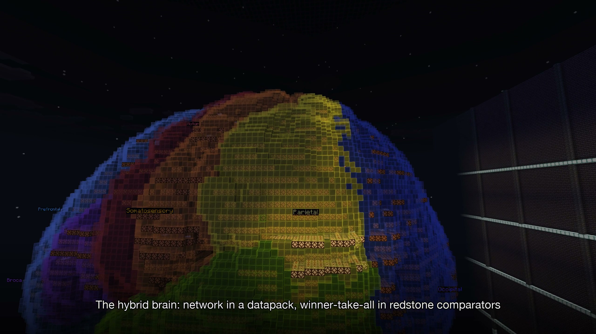

# Redstone Cortex



A brain in vanilla Minecraft 26.3, and a neuron whose math runs entirely through physical redstone.

There are two builds in this repo, and they are connected: the redstone neuron is built into the brain world and computes one of the brain's neurons, its judgment detector (the unit that feeds the prefrontal cortex), on every question.

## 1. The physical redstone neuron (new)

One complete neuron, 49,164 blocks, 460 x 501 blocks of floor. It computes

```
y = clamp(floor((w0*x0 + w1*x1 + b) / 4), 0, 15)
```

with every step in redstone. The two 4-bit inputs, two signed 5-bit weights and the signed 6-bit bias sit in repeater latches, loaded through write-enable rows; once loaded, the source pins are cleared and the latches hold. A crossbar feeds one stored operand pair per slot into a carry-save multiply-accumulate array (the bias goes in as two extra slots). A RUN latch and a 9-row delay-line sequencer clock the slots, flush the carries and fire the output strobe. Divide by 4 is just bit taps; the clamp is a saturation OR plus a sign kill. A 4-bit output latch drives 4 lamps.

Commands only set the input and weight pins, press START, and read block states afterwards. They never compute, select or set the result.

The demo: same inputs and bias, x0=5, x1=3, w1=-2, b=3. Store w0=4: the lamps show 4. Store w0=8: the lamps show 9. Filmed and logged in [docs/hw_demo_weight_change.txt](docs/hw_demo_weight_change.txt); the launch video and stills are described in [docs/RELEASE.md](docs/RELEASE.md).

Tests: 10/10 cases correct in game, identical to the redstone simulator, including saturation at 15, negative sums clamped to 0, and zero ([docs/hw_neuron_game.txt](docs/hw_neuron_game.txt)). One evaluation is 2850 game ticks: 144 s at 20 TPS, 28.8 s at `/tick rate 100`, 24/24 correct from 20 to 100 TPS ([benchmark](docs/hw_neuron_tps.md)).

Limits: the next START must wait 400 game ticks while the delay line drains; the harness enforces it, the circuit does not. It is one neuron of the brain's 24, not a network.

## 2. The anatomical brain (hybrid)

An upright brain of 45,551 redstone lamps, shaped from the MNI152 template and the Harvard-Oxford atlas, with both hemispheres, cerebellum and brainstem, inside a lab. Write a question on a sign and press RUN:

- A small network (8 inputs, 16 hidden, 8 outputs) runs in the datapack, except for one hidden neuron.
- That neuron, P:Prefrontal (the judgment detector; it was the math detector P:Parietal until 2026-11-25), is the physical redstone neuron from section 1, built at (1000, 1300) in the same world. At the input stage the brain pauses, writes the prefrontal input into the neuron with w0 = 4 (other operands 0), presses START and waits for it to finish, about 150 s at 20 TPS. It then reads the 4 output latches and uses that value as the unit's drive. The datapack no longer computes that drive. Logged in [docs/hw_brain_link.txt](docs/hw_brain_link.txt).
- The 8 outputs then compete through physical comparators (winner-take-all). The winner's spike runs down a redstone axon and lights its brain region.
- TRAIN applies a bounded update to 128 synapses, which persists. Working memory keeps the last 5 runs. Region, synapse and axon lesions with REPAIR; the axon lesion is a physical gate.

This is a neuroscience-inspired model, not a brain simulation.

## Reproduce the neuron

Needs a 26.3 server with RCON (the repo uses `server_hw/`, port 25596, RCON 25597).

```
cd hw
python3 neuron.py                 # 49164 blocks
python3 test_neuron.py            # redstone simulator
python3 test_neuron_game.py --build  # build at (1000, 1300), run the test cases in game
python3 demo_weight_change.py     # the w0 = 4 -> 8 demo
python3 test_neuron_tps.py 20 100 # tick-rate benchmark
```

## Build the brain

```
python3 -m venv .venv && .venv/bin/pip install numpy scipy nibabel nilearn nbtlib
.venv/bin/python gen.py
```

Copy `build/datapack/redstone_cortex` into a flat 26.3 world, run `/forceload add -80 -100 110 190` and `/function brain:build`. Tests: `python3 test.py` against RCON port 25599.

Docs: [architecture](docs/ARCHITECTURE.md), [guide](docs/GUIDE.md), [brain tests](docs/TEST_REPORT_UPRIGHT.md), [demo and video](docs/DEMO.md), [research notebook](docs/NOTEBOOK.md).
