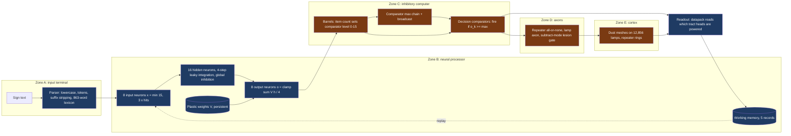

# Architecture (v3)

Which computation happens where. Blue nodes run in the datapack (commands). Orange nodes are physical redstone. The handoff points are the barrels: the datapack writes item counts, and every decision after that is made by comparators.

| Function | Implementation | Why |
|---|---|---|
| Reading the sign, tokenising, lexicon lookup | Datapack | Redstone cannot read text |
| 8-16-8 network arithmetic (about 300 multiply-adds per run) | Datapack scoreboards | Integer multiplication at this scale is impractical in blocks |
| Working memory, plastic weights, training rule | Datapack storage and scoreboards | Persistent state with 128 plastic synapses |
| Score to signal strength | Barrel item counts read by comparators | Physical analog encoding, verified for all 16 levels |
| Finding the maximum, suppressing weaker channels, ties | Comparator chain and decision comparators | Physical winner-take-all; the datapack never chooses the winner |
| Visible competition | Display comparators driving lamp bars while inhibition ramps | Physical comparison; the ramp only changes when inhibitory barrels fill |
| Axon transmission and axon lesions | Repeaters, dust on lamps, subtract-mode comparator gated by a lever | Physical interruption |
| Cortex activation | Dust meshes and 1,698 repeaters | Physical; no command touches a cortex lamp |
| Region lesion, synapse lesion | Datapack reads the lever and zeroes the neuron or synapse | Applied to the numerical model, which then feeds the physical circuit |
| Reporting the outcome (status text, memory) | Datapack reads tract and cortex block states | Read-only observation of the physical result |

Command blocks in the world: zero. Console buttons are polled by the datapack tick function (rising-edge detection).
